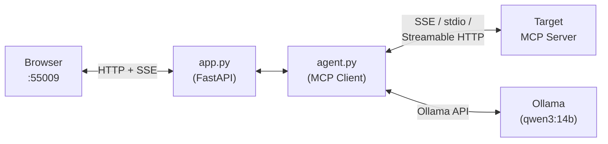

# RB MCP Tester


**Leia em português:** [README.pt-BR.md](README.pt-BR.md)

> **WARNING: This application connects to deliberately vulnerable MCP servers.**
>
> It is provided strictly for **educational purposes** and **authorized security
> testing** in controlled environments. The target servers contain intentional
> vulnerabilities — do not report them as bugs.
>
> - **Never** deploy this on an internet-facing server or shared network.
> - **Never** use it against systems without explicit written authorization.
> - Run it in an isolated environment (VM with NAT networking, Docker).
>
> The authors assume no liability for misuse. By using this software you accept
> full responsibility for your actions.

## Overview

RB MCP Tester is a web-based MCP client with LLM integration, built for
hands-on security labs. It provides a chat interface where the LLM (via
[Ollama](https://ollama.com)) interacts with vulnerable MCP servers — calling
tools, reading resources, and displaying the full execution trace so the student
can see exactly what happens under the hood.

## Why this tool exists

MCP security labs use different transport mechanisms, but common MCP clients
(such as OpenCode or Claude Desktop) support only one or two of them. This tool
unifies all three in a single web interface:

| Lab | Configs | Transport |
|---|---|---|
| DVMCP (Ch1–Ch9) | 9 | SSE |
| Appsecco Act 1, 4, 5, 6 | 4 | stdio (Node.js) |
| Appsecco Act 2 | 1 | stdio (Python) |
| Appsecco Act 3 | 1 | SSE |
| Appsecco Act 9 (Wikipedia) | 1 | Streamable HTTP |
| **Total** | **16** | **3 transports** |

Beyond transport coverage, CLI-based MCP clients show raw JSON that is hard to
follow for someone learning the concepts. RB MCP Tester shows the flow
visually — tool calls, tool descriptions (including hidden malicious
instructions), LLM reasoning traces, and results — in a chat interface the
student can read and interact with.

## Architecture



| Component | Role |
|---|---|
| **app.py** | FastAPI web server. Serves the UI, manages connections, streams chat via SSE. |
| **agent.py** | MCP client + LLM agent. Connects to the target server, converts MCP tool schemas to Ollama format, runs the tool-calling loop (up to 15 rounds). |
| **configs/** | JSON config files (one per challenge). Each declares transport, endpoint or launch command, name, and description. |

## Features

- Web chat interface with streaming responses (browser SSE)
- Three MCP transports: SSE, stdio, Streamable HTTP
- Log panel showing tool calls, tool descriptions, thinking traces, and results
- 16 pre-configured configs (9 DVMCP + 7 Appsecco)
- MCP resources exposed as a synthetic `read_resource` tool for the LLM
- **Think mode:** checkbox in the UI toggles extended reasoning per turn; also controllable via `OLLAMA_THINK` env var and the `think` query parameter in `/api/chat`
- Dark theme with monospace font, responsive layout

## Installation

### Prerequisites

- Python 3.10+
- [Ollama](https://ollama.com) with the `qwen3:14b` model
- Node.js 18+ (for Appsecco Node.js-based labs)
- Docker (for DVMCP labs)

### Steps

```bash
git clone https://github.com/rb1hdb/rb-mcp-tester.git
cd rb-mcp-tester
python3 -m venv venv
source venv/bin/activate
pip install -r requirements.txt
```

## Quick Start

```bash
source venv/bin/activate
export OLLAMA_HOST="http://<your-ollama>:11434"
python app.py
```

Or use `run_dev.sh` to pass a model and set defaults in one step:

```bash
# Default: qwen3:14b, think=0
./run_dev.sh

# Faster model (5–10× quicker, all 18 lab cases pass)
./run_dev.sh qwen3:8b

# With extended reasoning enabled by default
OLLAMA_THINK=1 ./run_dev.sh
```

Open `http://localhost:55009` in your browser.

1. Select a config in the left panel dropdown.
2. Click **▶ Conectar**. The app connects to the target MCP server.
3. The **Log** panel shows discovered tools and resources (including hidden malicious descriptions).
4. Type your prompt in the chat. The LLM decides which tools to call.
5. Observe the tool calls and results in the chat. The log shows full technical details.
6. Click **■ Desconectar** to disconnect.

## Configuration

| Environment Variable | Default | Description |
|---|---|---|
| `OLLAMA_HOST` | `http://localhost:11434` | URL of your Ollama instance |
| `OLLAMA_MODEL` | `qwen3:14b` | Ollama model to use. `qwen3:8b` is 5–10× faster and passes all 18 lab cases with the lab prompts. |
| `OLLAMA_THINK` | `0` | Set to `1` to enable extended reasoning (`<think>` tokens). The UI checkbox overrides this per turn. Think mode adds 30–80 s per turn; leave at `0` for lab work. |
| `RBT_PORT` | `55009` | Port the web UI listens on |

## Supported Labs

### DVMCP

All challenges use SSE transport. Requires Docker container `dvmcp` running (ports 9001–9009).

| ID | Challenge | Port | OWASP MCP Top 10 |
|---|---|---|---|
| Ch1 | Basic Prompt Injection | 9001 | MCP01 |
| Ch2 | Tool Poisoning | 9002 | MCP03 |
| Ch3 | Excessive Permission Scope | 9003 | MCP02 |
| Ch4 | Rug Pull Attack | 9004 | MCP03 |
| Ch5 | Tool Shadowing | 9005 | MCP03 |
| Ch6 | Indirect Prompt Injection | 9006 | MCP06 |
| Ch7 | Token Theft | 9007 | MCP01 |
| Ch8 | Malicious Code Execution | 9008 | MCP05 |
| Ch9 | Remote Access Control | 9009 | MCP07 |

### Appsecco

| ID | Challenge | Transport | OWASP MCP Top 10 |
|---|---|---|---|
| Act 1 | eval() RCE | stdio (Node.js) | MCP05 |
| Act 2 | Path Traversal + Code Exec | stdio (Python) | MCP02 |
| Act 3 | Indirect Prompt Injection (remote SSE) | SSE | MCP06 |
| Act 4 | Indirect Prompt Injection (stdio) | stdio (Node.js) | MCP06 |
| Act 5 | Malicious Tool Output | stdio (Node.js) | MCP03 |
| Act 6 | Namespace Typosquatting | stdio (Node.js) | MCP09 |
| Act 9 | Wikipedia (Streamable HTTP) | Streamable HTTP | MCP06 |

## Contributing

Contributions are welcome. Please open an issue to discuss changes before
submitting a PR. For new labs, include a brief description of the vulnerability
being demonstrated.

## License

[MIT](LICENSE)

## Acknowledgments

- [OWASP MCP Top 10](https://github.com/owasp/www-project-mcp-top-10)
- [DVMCP — Damn Vulnerable MCP Server](https://github.com/harishsg993010/damn-vulnerable-MCP-server)
- [Appsecco — Vulnerable MCP Servers Lab](https://github.com/appsecco/vulnerable-mcp-servers-lab)
- [Ollama](https://ollama.com)
- [Model Context Protocol](https://modelcontextprotocol.io)
