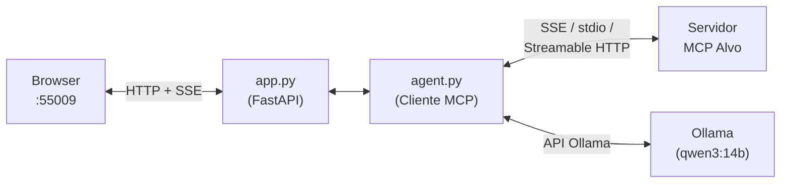

# RB MCP Tester


**Read in English:** [README.md](README.md)

> **AVISO: Esta aplicação conecta a servidores MCP intencionalmente vulneráveis.**
>
> Fornecida exclusivamente para **fins educacionais** e **testes de segurança
> autorizados** em ambientes controlados. Os servidores-alvo contêm
> vulnerabilidades intencionais — não as reporte como bugs.
>
> - **Nunca** exponha esta ferramenta à internet ou a redes compartilhadas.
> - **Nunca** use contra sistemas sem autorização explícita por escrito.
> - Execute em ambiente isolado (VM com rede NAT, Docker).
>
> Os autores não se responsabilizam por uso indevido. Ao usar este software você
> aceita total responsabilidade por suas ações.

## Visão geral

O RB MCP Tester é um cliente MCP web com integração de LLM, construído para
labs práticos de segurança. Ele oferece uma interface de chat onde o LLM (via
[Ollama](https://ollama.com)) interage com servidores MCP vulneráveis — chamando
ferramentas, lendo recursos e exibindo o trace completo de execução para que o
aluno veja exatamente o que acontece por baixo dos panos.

## Por que esta ferramenta existe

Os labs de segurança MCP usam diferentes mecanismos de transporte, mas clientes
MCP comuns (como OpenCode ou Claude Desktop) suportam apenas um ou dois deles.
Esta ferramenta unifica os três em uma única interface web:

| Lab | Configs | Transporte |
|---|---|---|
| DVMCP (Ch1–Ch9) | 9 | SSE |
| Appsecco Act 1, 4, 5, 6 | 4 | stdio (Node.js) |
| Appsecco Act 2 | 1 | stdio (Python) |
| Appsecco Act 3 | 1 | SSE |
| Appsecco Act 9 (Wikipedia) | 1 | Streamable HTTP |
| **Total** | **16** | **3 transportes** |

Além da cobertura de transportes, clientes MCP baseados em CLI mostram JSON cru
que é difícil de acompanhar para quem está aprendendo os conceitos. O RB MCP
Tester mostra o fluxo visualmente — chamadas de ferramenta, descrições de
ferramentas (incluindo instruções maliciosas ocultas), traces de raciocínio do
LLM, e resultados — em uma interface de chat que o aluno consegue ler e
interagir.

## Arquitetura



| Componente | Função |
|---|---|
| **app.py** | Servidor web FastAPI. Serve a UI, gerencia conexões, transmite chat via SSE. |
| **agent.py** | Cliente MCP + agente LLM. Conecta ao servidor-alvo, converte schemas de ferramentas MCP para o formato Ollama, executa o loop de chamadas de ferramentas (até 15 rodadas). |
| **configs/** | Arquivos JSON de configuração (um por desafio). Cada um declara transporte, endpoint ou comando de inicialização, nome e descrição. |

## Funcionalidades

- Interface de chat web com respostas em streaming (SSE no browser)
- Três transportes MCP: SSE, stdio, Streamable HTTP
- Painel de log com chamadas de ferramentas, descrições, traces de raciocínio e resultados
- 16 configs pré-configuradas (9 DVMCP + 7 Appsecco)
- Recursos MCP expostos como ferramenta sintética `read_resource` para o LLM
- **Modo Raciocínio (think):** checkbox na UI ativa/desativa o raciocínio estendido por turno; também controlável via variável de ambiente `OLLAMA_THINK` e pelo parâmetro `think` em `/api/chat`
- Tema escuro com fonte monospace, layout responsivo

## Instalação

### Pré-requisitos

- Python 3.10+
- [Ollama](https://ollama.com) com o modelo `qwen3:14b`
- Node.js 18+ (para labs Appsecco baseados em Node.js)
- Docker (para labs DVMCP)

### Passos

```bash
git clone https://github.com/rb1hdb/rb-mcp-tester.git
cd rb-mcp-tester
python3 -m venv venv
source venv/bin/activate
pip install -r requirements.txt
```

## Início rápido

```bash
source venv/bin/activate
export OLLAMA_HOST="http://<seu-ollama>:11434"
python app.py
```

Ou use o `run_dev.sh` para passar modelo e configurações em um só passo:

```bash
# Padrão: qwen3:14b, raciocínio desligado
./run_dev.sh

# Modelo mais rápido (5–10× mais rápido, todos os 18 casos de lab passam)
./run_dev.sh qwen3:8b

# Com raciocínio estendido ligado por padrão
OLLAMA_THINK=1 ./run_dev.sh
```

Abra `http://localhost:55009` no navegador.

1. Selecione uma config no dropdown do painel esquerdo.
2. Clique em **▶ Conectar**. O app conecta ao servidor MCP alvo.
3. O painel de **Log** mostra as ferramentas e recursos descobertos (incluindo descrições maliciosas ocultas).
4. Digite seu prompt no chat. O LLM decide quais ferramentas chamar.
5. Observe as chamadas de ferramentas e resultados no chat. O log mostra os detalhes técnicos.
6. Clique em **■ Desconectar** para desconectar.

## Configuração

| Variável de ambiente | Padrão | Descrição |
|---|---|---|
| `OLLAMA_HOST` | `http://localhost:11434` | URL da sua instância Ollama |
| `OLLAMA_MODEL` | `qwen3:14b` | Modelo Ollama a usar. `qwen3:8b` é 5–10× mais rápido e passa todos os 18 casos dos labs com os prompts fornecidos. |
| `OLLAMA_THINK` | `0` | Defina como `1` para ativar o raciocínio estendido (tokens `<think>`). O checkbox da UI sobrescreve por turno. O modo think adiciona 30–80 s por turno; deixe em `0` para os labs. |
| `RBT_PORT` | `55009` | Porta em que a UI web escuta |

## Labs suportados

### DVMCP

Todos os desafios usam transporte SSE. Requer o container Docker `dvmcp` rodando (portas 9001–9009).

| ID | Desafio | Porta | OWASP MCP Top 10 |
|---|---|---|---|
| Ch1 | Basic Prompt Injection | 9001 | MCP01 |
| Ch2 | Tool Poisoning | 9002 | MCP03 |
| Ch3 | Excessive Permission Scope | 9003 | MCP02 |
| Ch4 | Rug Pull Attack | 9004 | MCP03 |
| Ch5 | Tool Shadowing | 9005 | MCP03 |
| Ch6 | Indirect Prompt Injection | 9006 | MCP06 |
| Ch7 | Token Theft | 9007 | MCP01 |
| Ch8 | Malicious Code Execution | 9008 | MCP05 |
| Ch9 | Remote Access Control | 9009 | MCP07 |

### Appsecco

| ID | Desafio | Transporte | OWASP MCP Top 10 |
|---|---|---|---|
| Act 1 | eval() RCE | stdio (Node.js) | MCP05 |
| Act 2 | Path Traversal + Code Exec | stdio (Python) | MCP02 |
| Act 3 | Indirect Prompt Injection (SSE remoto) | SSE | MCP06 |
| Act 4 | Indirect Prompt Injection (stdio) | stdio (Node.js) | MCP06 |
| Act 5 | Malicious Tool Output | stdio (Node.js) | MCP03 |
| Act 6 | Namespace Typosquatting | stdio (Node.js) | MCP09 |
| Act 9 | Wikipedia (Streamable HTTP) | Streamable HTTP | MCP06 |

## Contribuindo

Contribuições são bem-vindas. Abra uma issue para discutir alterações antes de
enviar um PR. Para novos labs, inclua uma breve descrição da vulnerabilidade
demonstrada.

## Licença

[MIT](LICENSE)

## Agradecimentos

- [OWASP MCP Top 10](https://github.com/owasp/www-project-mcp-top-10)
- [DVMCP — Damn Vulnerable MCP Server](https://github.com/harishsg993010/damn-vulnerable-MCP-server)
- [Appsecco — Vulnerable MCP Servers Lab](https://github.com/appsecco/vulnerable-mcp-servers-lab)
- [Ollama](https://ollama.com)
- [Model Context Protocol](https://modelcontextprotocol.io)
